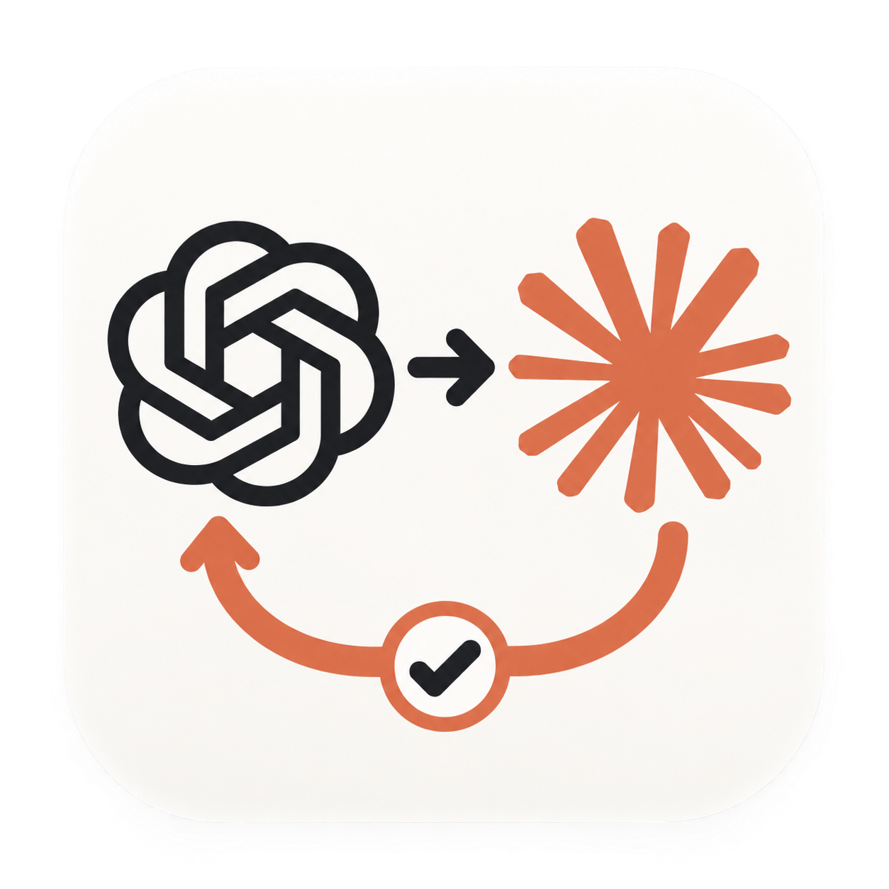

# Codex–Claude Collaboration · 1.0.1

[简体中文](README.md) · **English**

<p align="center">
  
</p>

<p align="center">
  <strong>Claude does the work. Codex reviews it.</strong><br>
  You ask in Codex. Claude works in a copy of your project.<br>
  Codex reviews the result before it reaches you.
</p>

<p align="center">
  macOS · Codex desktop · Local Claude Code<br>
  <a href="docs/getting-started.en.md">Get started</a> ·
  <a href="#how-to-use">Examples</a> ·
  <a href="https://github.com/BryanYue/codex-claude-orchestrator/issues">Report an issue</a>
</p>

## What it does

If you use both Codex and Claude, you probably move requirements, code and review notes between two windows. This plugin lets you stay in Codex. You describe the goal, and Codex hands your exact words, the relevant files and its own reading to your local Claude Code as separate parts. Claude returns a report and its changes, and Codex reviews them.

**You ask → Claude works → Codex reviews → You get the result**

| Feature | What it means |
| --- | --- |
| Write code | Claude edits a copy and runs the tests |
| Review | Conclusion first, then the evidence |
| Track progress | See where it stands in the Workbench |
| Keep going | Add to the chat; the next round continues |

Current release: [`v1.0.1`](https://github.com/BryanYue/codex-claude-orchestrator/releases/tag/v1.0.1) (2026-10-15) · [Changelog](CHANGELOG.md) · [Verification record](RELEASE-VERIFICATION.md)

## Get started

### 1. What you need

- **Codex desktop**, signed in, with a version that supports plugins. [Setup guide](https://developers.openai.com/codex/app)
- **Claude Code**, installed locally, signed in and with usage available. The plugin uses your local Claude Code directly; it never downloads, updates or switches its version. [Install and sign in](https://code.claude.com/docs/en/quickstart)
- **uv**, which prepares the plugin's runtime environment. [Installation guide](https://docs.astral.sh/uv/getting-started/installation/)

The plugin targets macOS. Implementation tasks and the default analysis tasks need macOS's built-in `sandbox-exec` to protect the original repository. When it is unavailable, analysis tasks can use Read-only mode instead. Intel Macs have not been separately verified.

### 2. Install

Run these commands in your terminal, one at a time:

```bash
codex plugin marketplace add https://github.com/BryanYue/codex-claude-orchestrator.git --ref v1.0.1
codex plugin add codex-claude-orchestrator@codex-claude-team
```

The first adds the plugin source; the second installs the plugin. The repository is public, so no GitHub invitation or sign-in is needed. Older release tags stay frozen. A fixed ref does not upgrade by itself; to switch versions, follow the [version-switching steps](docs/git-marketplace.md#change-a-fixed-ref-or-migrate-from-zip).

**On first installation, also prepare the dependencies, then open a new Codex task.** If you are not comfortable with the terminal, see `codex: command not found`, or installed a local version before, follow the [step-by-step guide](docs/getting-started.en.md).

### 3. Try it

Open your project in Codex, start a new task and send this request. Replace the filename with a real file in your project:

> Use the Codex–Claude collaboration plugin to have Claude look at the installation steps in README.md: where is a beginner most likely to get stuck? Don't change any files yet; check its conclusions and then tell me.

This is a real Claude request and uses your Claude allowance. You will see execution progress, Claude's report and Codex's review. **A returned report is not completion; the work is done only after Codex has reviewed it.**

## How to use

**Follow a plan**

> Following phase two of docs/plan.md, have Claude make the export asynchronous. When it's done, check the changes and run the tests, and apply them to the project only if everything holds up.

**Ask a question**

> Have Claude assess whether we can move session storage to SQLite, focusing on concurrency and migration cost. Give me the conclusion first.

**Review changes**

> Have Claude review the current uncommitted changes, looking only at error handling and test coverage, and reproduce any issue it suspects in the copy.

**Correct course**

> That's not what I meant: keep the existing login flow and only change the error messages. Have Claude continue from the previous round.

**Check progress**

> Open the Workbench for this task.

The filenames and tasks are examples; replace them with your own.

## Safety boundaries

- **The brief**: your words come first, verbatim. Then come the attachments (specs, plans and so on), Codex's notes, the constraints and the completion criteria. Codex's notes are marked "may be wrong". Each constraint is marked as coming from you, an attachment or Codex. The brief also says which part wins when they conflict. In the next round, your new words are appended verbatim, along with Codex's corrections and item-by-item review. You can read the exact brief Claude received in the Workbench.
- **Copy mode (default for Git projects)**: Claude works in an independent Git copy of your project. The copy reflects the current state, including uncommitted changes. Claude can edit, run commands and tests, and use Agent/Skill/Workflow. macOS denies writes to the original repository, its `.git` and the plugin's run records. Network, credentials and other local paths are not isolated. External MCP is off. Sensitive untracked files such as `.env`, `.claude`, `.codex` and `.ssh` are not copied.
- **Read-only mode**: Claude works read-only in the original directory and can only read and search. Web access requires your consent. The report comes back as structured output. Suited to plain document folders, or when you don't want any command executed.
- **Claude configuration**: Claude loads your global and project `CLAUDE.md`, rules and hooks as usual. The plugin lists which ones this session loaded. The brief states that it wins when they conflict.

## Workbench

- Every round of a task is on one page. The labels are in Chinese. A one-line status at the top says where things stand, such as "Codex review: Passed with fixes, next: another round" or "Claude is working · 3 min so far".
- When Claude has a question only you can decide, a blue "Claude has a question for you" box appears at the very top.
- Below are three panels: **Status** (how the process ended), **Claude's self-check** (whether it says it finished) and **Codex review** (Passed, Passed with fixes or Sent back, plus the next step).
- Warnings are explained in Chinese, for example when a change touched a protected path. Technical details are collapsed.
- The details tabs show the report, this round's changes and the activity log. The activity log lists the tools Claude used and the files it read or wrote. The brief, your original words and more sit under "More".
- The page is for viewing only. Additional instructions, corrections and continuing the task still happen in the Codex conversation. When the Codex panel is narrow, the task list moves into a "Tasks" button at the top left.

## Common questions

**Whose allowance does it use?**

You need your own Codex and Claude Code access. The plugin does not supply or share accounts. Actual Claude runs and the online check use your Claude allowance. Viewing local status does not send a model request.

**Where does my code go?**

The brief and the files Claude reads are sent to the model service configured in your Claude Code setup. The Workbench and run records stay on your computer (by default under `~/.codex/claude-orchestrator/v1`). Follow your project's rules when deciding which files may go to a model.

**Will it change my project?**

Not directly. Claude only changes the copy. The plugin packages the changes, and Codex applies them to your project with `git apply` after reviewing them. The plugin does not merge, commit or publish anything automatically.

**Can I edit the project while it runs?**

Yes. Claude does not work in your project directory. If the project changes in the meantime, the result says so. Before applying the changes, Codex checks that they still apply without conflicts.

**Codex restarted. Now what?**

The task keeps running. After reconnecting, query it with the original run ID. If the supervising process exits unexpectedly, the plugin stops any leftover Claude processes, records the round as lost (失联) and collects the report and changes already written.

**How is cost calculated?**

The Workbench shows "约 $X（Claude 估算）", meaning "about $X (Claude's estimate)". It is the Claude client's estimate, not an actual charge or remaining subscription quota. It covers the whole Claude session, subagents included, so a continued round may also count earlier rounds.

**What should I watch for when upgrading from 0.7?**

1.0 is not compatible with old tasks. Old run records stay in their original location for reference but cannot be continued. Project adoption, automatic executor selection and online management of coordination guidance have been removed. See the [changelog](CHANGELOG.md).

## Learn more

| Topic | Where to look |
| --- | --- |
| First steps | [English guide](docs/getting-started.en.md) · [中文指南](docs/getting-started.zh-CN.md) |
| Update & rollback | [Git marketplace guide](docs/git-marketplace.md) · [Install and recovery](docs/install-and-recovery.md) |
| Advanced use | [Advanced guide — Chinese](docs/advanced-usage.zh-CN.md) |
| Release notes | [Changelog — Chinese](CHANGELOG.md) · [Verification record](RELEASE-VERIFICATION.md) |

## Release

Stable release: [`v1.0.1`](https://github.com/BryanYue/codex-claude-orchestrator/releases/tag/v1.0.1) (2026-10-15).

1.0.1 improves the Workbench:

- In a narrow Codex panel, the task list moves behind a "任务" button and details take the full width.
- A one-line status sits on top, and all labels use plain words.
- The activity log lists each tool Claude used and the files it read or changed.

1.0.1 can continue tasks started with 1.0.0.

[`v1.0.0`](https://github.com/BryanYue/codex-claude-orchestrator/releases/tag/v1.0.0) (2026-10-08) was a ground-up rebuild:

- The brief Claude receives is role-specific Markdown that carries your words verbatim.
- Implementation runs in an independent copy and returns its changes.
- The plugin reports facts and warnings and no longer decides on Codex's behalf that a run failed.

See the [changelog](CHANGELOG.md) for the changes and the [verification record](RELEASE-VERIFICATION.md) for what was and was not verified.

A community project maintained by [BryanYue](https://github.com/BryanYue), with no official affiliation with OpenAI or Anthropic. No open-source license has been selected. Feedback and suggestions are welcome in [Issues](https://github.com/BryanYue/codex-claude-orchestrator/issues).
